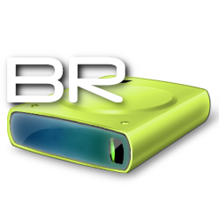
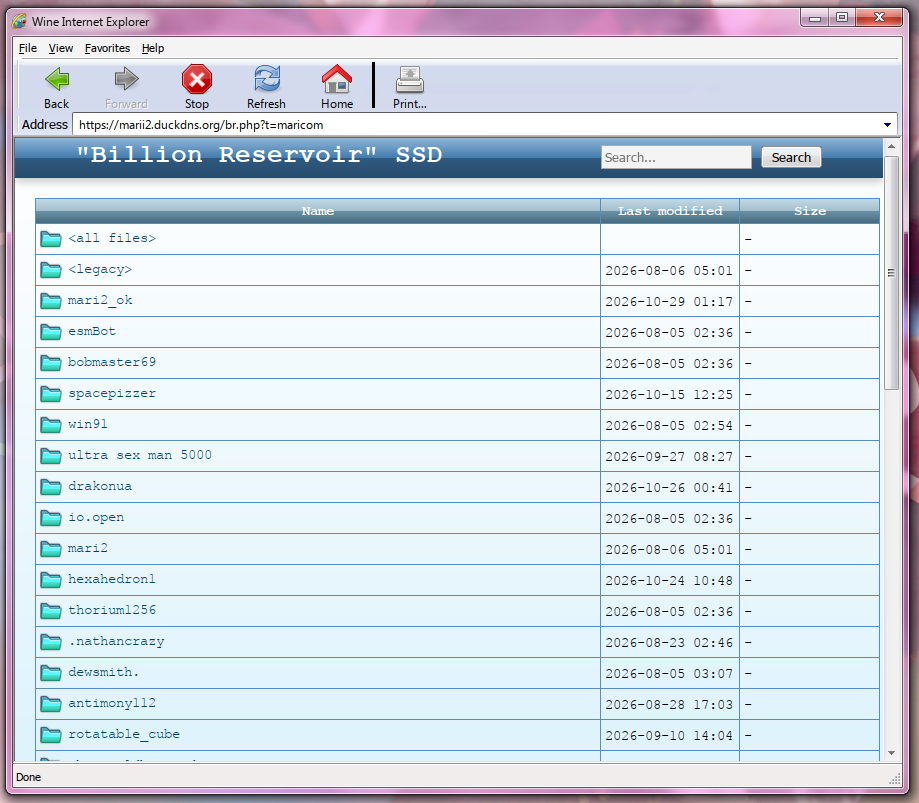

# "Billion Reservoir" SSD v2.1.3
"Billion Reservoir" SSD is a bot that downloads files sent on Discord and makes them available on a simple web frontend

"Billion Reservoir" SSD has a UX designed to feel like Windows Vista/7

Disclaimer: the name "Billion Reservoir" is likely a registered trademark of Shenzhen Yichu Electronics Co., Ltd., and the various Windows assets (inside of /br-emojis/) are copyright of Microsoft Corporation and are Licensed under Windows 7's EULA.

The Custom Icons in /bricons/ and /brthemes/maricom\* CSS themes are licensed under [CC BY-NC-SA 4.0 International](https://creativecommons.org/licenses/by-nc-sa/4.0/).

All assets included *within this repository* that are not licensed under CC BY-NC-SA or Microsoft's Windows 7 EULA are licensed under Apache-2.0.

